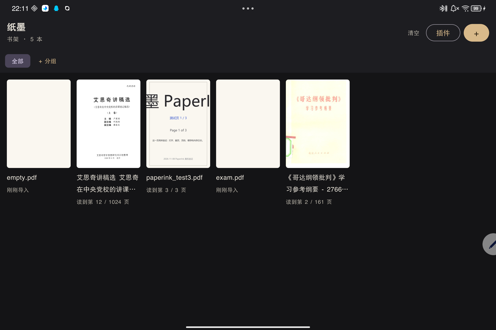
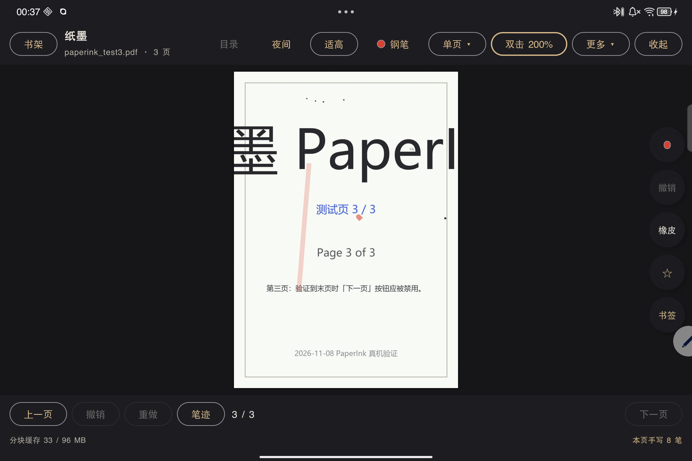
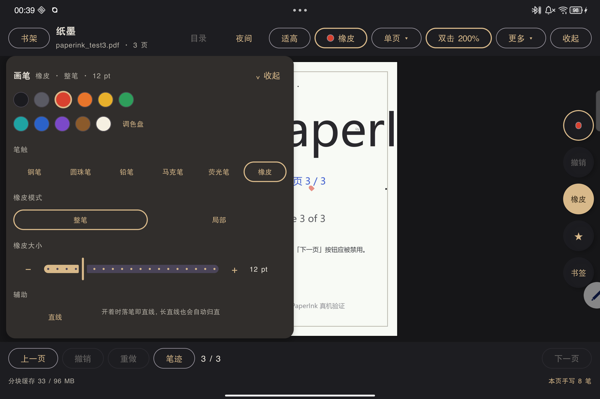
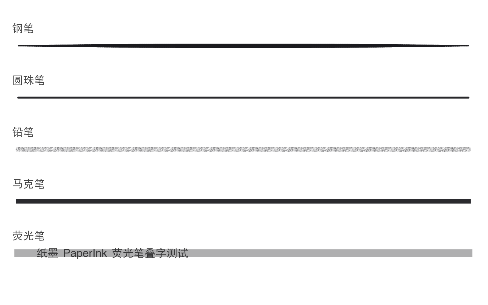
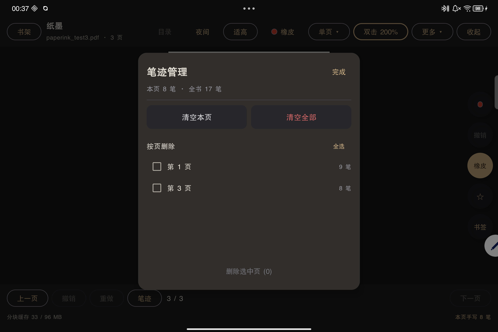
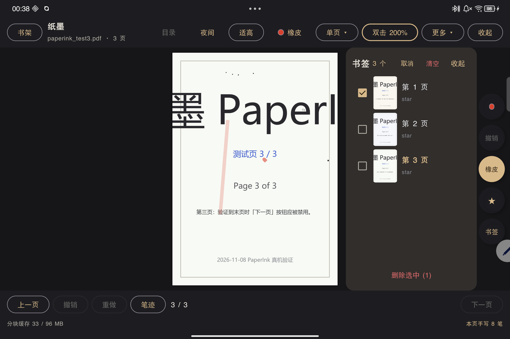

# 纸墨 PaperInk

**一款为 Android 平板手写笔优化的 PDF 阅读与批注应用。**

翻页要像翻纸，写字要像在纸上写：3D 卷曲翻页、低延迟手写批注、多笔型、书签、目录、插件扩展，全部本地完成。

<p>
  
  
  
  
</p>

- 当前版本：**v0.6.0（versionCode 27）**
- 安装包：[Releases · v0.6.0](https://github.com/qmzzn114614/PaperInk/releases/download/v0.6.0/paperink-0.6.0-debug.apk)（debug 签名，Android 8.0+；APK 作为 Release 附件发布，不进 git 仓库）
- 开发与真机验证记录：[`PROJECT_STATE.md`](PROJECT_STATE.md)

---

## 截图

| 书架与阅读进度 | 阅读页 · 荧光笔（10% 透明度） |
| :---: | :---: |
|  |  |

| 画笔工具面板（6 笔型，含橡皮） | 五种笔触样张 |
| :---: | :---: |
|  |  |

| 笔迹管理（按页清空 / 全书清空 / 按页删除） | 书签多选与一键清空 |
| :---: | :---: |
|  |  |

| 纸面外空白处书写（纸白色，与 PDF 纸白区分） |
| :---: |
|  |

| 插件管理（本地插件 + 插件市场） |
| :---: |
|  |

> 截图来自真机（联想拯救者 Y900 11，3840×2560 横屏）；主题为深色夜间界面，实际可关闭夜间模式。

---

## 简介

纸墨（PaperInk）是一个自用的 Android 平板 PDF 阅读器，重点解决两件事：

1. **阅读体验**：大屏平板上清晰、跟手地翻页与缩放，支持单页 / 上下滚动 / 双页跨页三种排版和 GPU 3D 卷曲翻页；
2. **手写批注**：手写笔直接写、手指只翻页（掌拒），提供钢笔、圆珠笔、铅笔、马克笔、荧光笔、橡皮，笔迹按页保存，并可把笔迹「烧」进 PDF 导出。

所有数据（PDF 索引、阅读进度、书签、手写笔迹）都保存在平板本机，**没有账号、没有广告、不上传任何阅读内容**。

### 版本与技术栈

| 项目 | 值 |
| --- | --- |
| 应用 ID | `com.dsh.paperink` |
| 当前版本 | v0.6.0（versionCode 27） |
| minSdk / targetSdk / compileSdk | 28 / 36 / 36 |
| 语言与 UI | Kotlin 2.1.21 + Jetpack Compose（BOM 2025.05.01） |
| PDF 渲染 | PDFium（`io.legere:pdfiumandroid:1.0.35`）分块渲染 + LRU Tile 缓存 |
| 3D 翻页 | OpenGL ES（`render/gl/PageCurlView.kt`） |
| 构建 | Gradle 8.11.1 + AGP 8.10.1，Gradle Wrapper 已内置 |
| 主要验证设备 | 联想拯救者 Y900 11（TB711FU，Android 16 / SDK 36，联想手写笔 Pro 2） |

---

## 功能特性

### 阅读

- **导入 PDF**：书架右上角「＋」走系统文件选择器（SAF，无需存储权限）；也支持在文件管理器里「用纸墨打开」。
- **分块渲染**：512px 瓦片按缩放档位按需渲染，LRU 缓存上限约 96 MB；双指缩放、拖动平移、双击缩放（比例可调）。
- **三种排版**：单页翻页 / 单页上下滚动 / 双页跨页，切换不丢当前页，笔迹不漂。
- **3D 卷曲翻页**：点屏幕左右边缘或从纸张边缘拖拽，松开自动判断「翻过去 / 弹回」。
- **页面尺寸**：适高 / 适宽 / 原始大小。
- **夜间模式**：只反亮度、保色相——扫描件变黑底浅字，彩色插图不会变底片。
- **目录（TOC）**：读取 PDF 内置大纲，点条目直接跳页；没有大纲的 PDF 自动禁用。
- **长按选字**：长按正文选中文字并复制（PDF 文本层可用时）。
- **书签**：右侧栏一键加/取消书签；书签面板可跳页，v0.6.0 起支持**多选删除**与**清空本书全部书签**（二次确认）。
- **阅读进度**：书架卡片显示「读到第 N / M 页」，再次打开自动回到上次位置。

### 手写批注

- **压感书写**：手写笔真实压感（最高 8192 级）逐点采样；笔尖书写、笔尾橡皮。
- **掌拒**：手写笔在屏上时屏蔽手指书写/翻页，手指始终只做翻页与缩放。
- **六种笔型**：钢笔 / 圆珠笔 / 铅笔 / 马克笔 / 荧光笔 / 橡皮。
- **11 色色板 + 自定义取色**：v0.6.0 新增「纸白」（`#F5F0E1`），刻意区别于 PDF 纯白，适合在页面外的深色空白区批注。
- **粗细 4 档**（细 / 中 / 粗 / 特粗）；荧光笔透明度可调（低透明度不盖字）。
- **橡皮**：整笔删除 / 局部擦除两种模式，擦除大小 4–40 pt 可调。
- **右侧悬浮橡皮按钮**（v0.6.0）：一键切到橡皮，再点一下切回上一支笔。
- **直线辅助**：开启后落笔即直线；长直线自动归直（阈值保守，圆弧不会被拉直）。
- **纸面外批注**（v0.6.0）：写在纸面外深色空白区的笔迹会保留显示，不再被裁掉。
- **撤销 / 重做**：按页维护操作历史。
- **笔迹落盘**：一个文档一份 JSON，停笔 400 ms 防抖保存；换页、退后台、杀进程后重开可恢复。
- **笔迹管理弹窗**（v0.6.0，底栏入口）：清空本页 / 清空全书 / 勾选页码批量删除笔迹（均不可撤销）。
- **导出扁平化 PDF**：把当前 PDF 与笔迹渲染成新 PDF，经系统「另存为」选择保存位置；导出的文件在任何阅读器里都能看到笔迹。

### 书架

- 封面缩略图、书名、页数、阅读进度；按分组管理（新建分组 / 移动 / 删除分组）。
- 长按书卡删除、顶栏「清空」清空书架。
- **安全承诺**：删除只删 App 自己的记录、封面和手写笔记，**绝不会修改或删除平板上的原始 PDF**。

### 插件

- 插件是**独立 APK**：宿主通过 `PackageManager` 发现、`PluginSignaturePolicy` 校验证书、插件运行在 `:plugin` 独立进程，插件崩溃或被杀不会带崩宿主。
- 四类能力：`document.format`（打开新格式）、`action.provider`（菜单动作）、`panel.provider`（侧栏面板）、`bookmark.provider`（手写书签识别）。
- 装/卸插件后通过系统广播自动热刷新，无需重启 App。
- 示例：`plugin-test/` 是可直接安装的测试插件；`plugin-test-untrusted/` 用于验证签名白名单拦截。
- **插件市场**（v0.6.0）：书架「插件」面板可从 GitHub 上托管的 `index.json` 拉取插件列表，索引地址为可替换的占位配置。托管与发布方案见 [`docs/PLUGIN_MARKET.md`](docs/PLUGIN_MARKET.md)。

### 安全与隐私

- 阅读内容、书架、书签、手写笔迹全部保存在本机；不上传、不联网同步（插件市场只读取公共 `index.json`）。
- PDF 通过系统文件选择器授权访问，不申请存储管理权限。
- 手写笔记与书签用 SQLite / JSON 存于应用私有目录，卸载即清除。

---

## 下载与安装

1. 从 GitHub Releases 页面（`https://github.com/qmzzn114614/PaperInk/releases/tag/v0.6.0`）下载 `paperink-0.6.0-debug.apk`；仓库里只保留 `dist/SHA256SUMS.txt` 用于校验。
2. 把 APK 传到平板（数据线 / 微信文件传输 / 网盘均可），点击安装；系统提示「未知来源」时允许本次安装。
3. 打开 App，点书架右上角「＋」导入第一本 PDF。

**系统要求**：Android 8.0（API 28）及以上；推荐 arm64 平板 + 手写笔。当前主要在联想拯救者 Y900 11（Android 16）上验证，其它机型未逐一验证（压感、掌拒、120Hz 高刷取决于硬件）。

> 这是 **debug 签名**安装包：体积约 46–48 MB、启动略慢，不能上架应用商店。若平板上已装过其它签名的同包名版本，需要先卸载（会丢弃本机笔记，请先导出 PDF）。

---

## 构建

### 环境要求

- **JDK 21**（Gradle 8.11.1 的运行环境；Kotlin/Java 目标字节码为 17）
- **Android SDK**：Platform 36、Build-Tools 36.0.0（`compileSdk = 36`）
- Windows / macOS / Linux 均可；Windows 使用仓库自带的 `gradlew.bat`
- 首次构建需要网络下载 Gradle 与 Maven 依赖

### Windows PowerShell（可直接复制）

```powershell
# 1) 按你的机器修改这两个路径
$env:JAVA_HOME     = "C:\Program Files\Java\jdk-21"
$env:ANDROID_HOME  = "$env:LOCALAPPDATA\Android\Sdk"

# 2) 进入工程目录
Set-Location D:\PaperInk

# 3) 生成 local.properties（已被 .gitignore 忽略，不会提交）
"sdk.dir=$($env:ANDROID_HOME -replace '\\','/')" | Set-Content -Path .\local.properties -Encoding ascii

# 4) 构建 debug APK
.\gradlew.bat assembleDebug

# 5) 产物位置
#    app\build\outputs\apk\debug\app-debug.apk
```

Linux / macOS 把最后一步换成 `./gradlew assembleDebug`。

### 说明

- 用 Android Studio 打开工程也可以：IDE 会自动生成 `local.properties`，并提示安装缺失的 SDK 组件。
- 仓库里的 `gradle.properties` 未写死任何开发机路径；Gradle 会使用默认的 `~/.gradle` 缓存。若需要自定义，可在本机 `gradle.properties` 里加 `-Duser.home=...`。
- 构建 Android 仪器测试：`.\gradlew.bat assembleDebugAndroidTest`；安装到设备：`adb install -r app\build\outputs\apk\debug\app-debug.apk`。
- 发行时把 APK 上传到 GitHub Release（不打进 git 树，单文件约 48 MB 会超过 API/仓库友好体积），并更新仓库里的 `dist/SHA256SUMS.txt`。

---

## 目录结构

```text
PaperInk/
├── app/                          # Android 主应用
│   └── src/main/java/com/dsh/paperink/
│       ├── MainActivity.kt       # Compose 外壳、顶栏/底栏/阅读界面
│       ├── ReaderViewModel.kt    # 阅读器状态机（翻页/缩放/笔迹/目录/导出）
│       ├── document/             # PDFium 分块渲染、Tile 缓存、PDF 扁平化导出
│       ├── ink/                  # 笔迹模型、笔型、压感、防抖落盘、直线归直
│       ├── library/              # 书架、封面、阅读进度、书签、SQLite
│       ├── host/                 # 插件发现、连接、签名白名单、热插拔
│       ├── render/gl/            # OpenGL 3D 卷曲翻页
│       └── ui/                   # Compose 组件、手写层、工具栏、目录/书签/插件面板
├── plugin-api/                   # 插件协议模块（AIDL + 宿主/插件共用接口）
├── plugin-test/                  # 示例插件（同签名，可安装热插拔）
├── plugin-test-untrusted/        # 拒绝加载场景的测试插件（验证签名白名单）
├── dist/                         # 发行校验文件 SHA256SUMS.txt（APK 走 GitHub Release）
├── docs/                         # 发布教程、插件市场方案与截图
│   ├── GITHUB_RELEASE_GUIDE.md   # 从零发布到 GitHub 的完整教程
│   ├── PLUGIN_MARKET.md          # 插件市场托管方案
│   └── images/                   # README 截图
├── gradle/libs.versions.toml     # 依赖版本集中管理
├── settings.gradle.kts           # 模块声明
├── build.gradle.kts              # 根构建脚本
├── gradlew / gradlew.bat         # Gradle Wrapper
├── PROJECT_STATE.md              # 开发过程与真机验证记录（体量较大）
├── README.md
├── LICENSE
└── .gitignore
```

---

## 插件机制

插件不是脚本，也不是动态加载的 dex，而是**独立安装的 APK**：

1. 插件 Service 声明 `com.dsh.paperink.plugin.BIND` action，并设置 `android:process=":plugin"`，崩溃隔离在插件进程；
2. 宿主通过 PackageManager 发现插件，用 `PluginSignaturePolicy` 校验签名证书 SHA-256（宿主同签名，或命中显式白名单）；
3. 宿主与插件只通过一个跨进程入口通信：`IPluginService.invoke(actionId, Bundle, Bundle)`。协议只加字段、不改语义，老插件不会因为宿主升级而失联；
4. 宿主提供四类能力接口（`DocumentFormat` / `ActionProvider` / `PanelProvider` / `BookmarkProvider`），插件按需实现；
5. 插件安装/卸载/升级时，宿主收到系统广播后自动重新扫描，不用重启 App。

插件协议源码见 [`plugin-api/`](plugin-api/)；市场托管、`index.json` schema 与作者发布流程见 [`docs/PLUGIN_MARKET.md`](docs/PLUGIN_MARKET.md)。

> 安全提示：插件是第三方可执行代码。宿主默认只信任与自身相同签名的插件；第三方插件需要开发者把证书指纹提交到宿主白名单后才能加载。安装来源不明的插件有风险，请自行确认。

---

## 已知限制

- **笔记只存在本机**，没有云同步；卸载 App / 清除应用数据会连笔记一起删掉，重要笔记请先「导出 PDF」。
- 笔记按 PDF 的 **URI 关联**，移动或重命名原文件后可能认不出旧笔记。
- **笔身振动**依赖厂商系统「书写反馈」白名单；第三方 App 无法逐笔控制笔马达，换机型只有画面/音效反馈。
- 部分功能依赖手写笔：没有手写笔也能阅读，但无法书写（手指会作为翻页手势处理）。
- 长按选字依赖 PDF 文本层；扫描版 PDF 只能手写批注。
- 清空笔迹、清空书架等操作**不可撤销**。
- 当前为 debug 构建，未做混淆与上架适配。

---

## 相关文档

- [`docs/GITHUB_RELEASE_GUIDE.md`](docs/GITHUB_RELEASE_GUIDE.md)：从安装 Git 到发布 v0.6.0 Release 的完整教程（面向不熟悉 Git 的读者）。
- [`docs/PLUGIN_MARKET.md`](docs/PLUGIN_MARKET.md)：插件市场仓库结构、`index.json` schema、GitHub Pages 托管与发布流程。
- [`PROJECT_STATE.md`](PROJECT_STATE.md)：开发过程、真机验证证据与每轮改动记录。

---

## 许可证

本项目使用 [MIT License](LICENSE)，Copyright (c) 2026 PaperInk contributors。

第三方依赖遵循其各自许可证：PDFium（BSD-3-Clause）、AndroidX / Jetpack Compose（Apache-2.0）、Kotlin（Apache-2.0）等。

---

## 免责声明

- 本项目是个人学习与自用项目，按 **MIT License「AS IS」** 提供，不提供任何明示或暗示的担保；作者不对使用本软件造成的设备损坏、数据丢失、法律风险或其它损失负责。
- 手写笔记、阅读进度、书签仅保存在本机。卸载、清数据、刷机或系统清理都可能导致数据丢失，请务必定期「导出 PDF」备份重要批注。
- 书架中的「删除」「清空」只删除 App 内部记录、封面与笔记，**不会动平板里的原始 PDF**。
- debug APK 只适合个人侧载测试，不适合分发到应用商店；从非官方渠道获取的安装包请自行承担风险。
- 插件为第三方代码，安装前请确认来源与签名；因安装第三方插件导致的问题与本项目无关。
